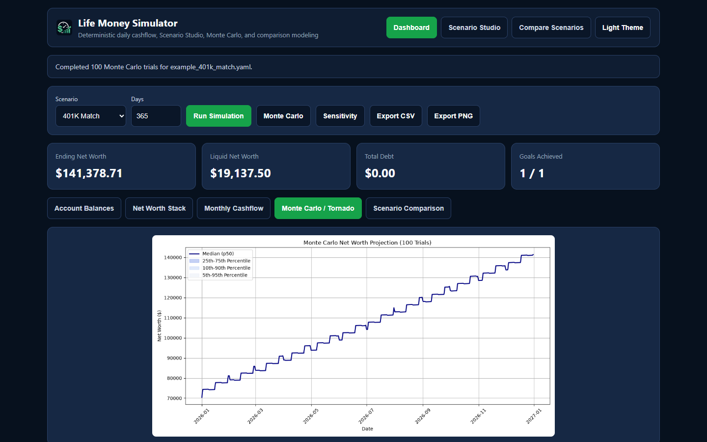

  

# Life Money Simulator

**Model your accounts, 401(k) matches, debt payoff, taxes, and Monte Carlo retirement odds on your computer.**

Life Money Simulator runs day-by-day personal finance projections locally in an interactive desktop window with zero accounts, zero subscriptions, and complete offline privacy. Test retirement strategies, waterfall transfers, and life milestones visually before making real-world plans.

---

## Download

| Platform | Download | How to Install |
| :--- | :--- | :--- |
| **Windows** | [TimeIsMoneySim-Windows.exe](https://github.com/DontKwo/time-is-money-sim/releases/latest/download/TimeIsMoneySim-Windows.exe) | [Windows Install Steps](docs/INSTALLATION.md#windows) |
| **macOS** | [TimeIsMoneySim-macOS.zip](https://github.com/DontKwo/time-is-money-sim/releases/latest/download/TimeIsMoneySim-macOS.zip) | [macOS Install Steps](docs/INSTALLATION.md#macos) |
| **Linux** | [TimeIsMoneySim-Linux.tar.gz](https://github.com/DontKwo/time-is-money-sim/releases/latest/download/TimeIsMoneySim-Linux.tar.gz) | [Linux Install Steps](docs/INSTALLATION.md#linux) |

Browse release notes on [All Releases](https://github.com/DontKwo/time-is-money-sim/releases/latest).

---

## Screenshots

  

  

---

## How to Use

1. **Download the app** from the table above for Windows, macOS, or Linux.
2. **Open the desktop window** following [Desktop Installation Guide](docs/INSTALLATION.md) if prompted by your operating system.
3. **Run & Explore on the Dashboard**: Pick a scenario template (`MVP`, `401k Match`, `Debt Payoff`, or `FIRE Lifecycle`) or click **Monte Carlo** and **Sensitivity**, then export CSV ledgers or chart PNGs anytime.
4. **Customize in Scenario Studio & Compare**: Build custom accounts, paychecks, flows, and life events visually in **Scenario Studio**, or benchmark two strategies side by side under **Compare Scenarios**.

---

## Key Features

- **Daily Calendar Accuracy**: Processes paychecks, taxes, credit cycles, loans, and compound returns day by day.
- **Visual Scenario Studio & Side-by-Side Comparison**: Edit financial scenarios without hand-writing YAML and compare multiple strategies against deterministic seeds.
- **Monte Carlo & Sensitivity**: Visualize probability bands across market paths and identify high-leverage savings choices.
- **Offline CSV & Chart PNG Exports**: Export transaction ledgers and charts locally with complete offline privacy.
- **Open Source**: Transparent simulation code under the [MIT License](LICENSE).

---

## Documentation

### User Documentation
- [User Guide](docs/USER_GUIDE.md)
- [Desktop Installation Guide](docs/INSTALLATION.md)
- [Configuration Reference](docs/CONFIG_REFERENCE.md)
- [Frequently Asked Questions](docs/FAQ.md)

### Developer Documentation
- [Developer Guide](docs/DEVELOPMENT.md)
- [Developer uv Installation](docs/UV_INSTALLATION.md)

### AI & Technical Documentation
- [AI Agent Rules](AGENTS.md)
- [System Architecture](docs/ARCHITECTURE.md)

### Legal & Security Policies
- [Security Policy](SECURITY.md)
- [Third-Party Notices](THIRD_PARTY_NOTICES.md)
- [MIT License](LICENSE)

---

## Safety & Disclaimers

- **Financial Disclaimer**: Life Money Simulator is an educational personal finance model. It does not provide financial, investment, tax, legal, or retirement advice. Verify outputs independently before making financial decisions.
- **Official `main` Releases Only**: Only download executables from [DontKwo/time-is-money-sim](https://github.com/DontKwo/time-is-money-sim/releases/latest) (`main` branch). Never download forked builds unless you have verified they contain no malware; only official `main` releases are maintained by the author, and I make no promises.
- **OS Security Warnings**: Windows SmartScreen and macOS Gatekeeper may flag unsigned open-source builds as unrecognized or unsafe. Bypassing prompts is strictly at your own discretion; see [Desktop Installation Guide](docs/INSTALLATION.md).
- **AS-IS Disclaimer**: Provided "AS IS" under the [MIT License](LICENSE) with zero warranty or liability. Use at your own risk.
